# Vidéo — installation (Windows)

Guide vidéo du pas-à-pas d'installation de **PrivateBrain** (PT2026 Desktop) sous Windows.

## Regarder la vidéo

**[▶ installation.mp4](installation.mp4)** (~7 Mo)

Sur GitHub : cliquez le fichier, puis **Download** ou lisez-le dans le lecteur du navigateur.

## Captures du pas-à-pas

| Étape | Capture |
|---|---|
| 1. Fichier installateur | 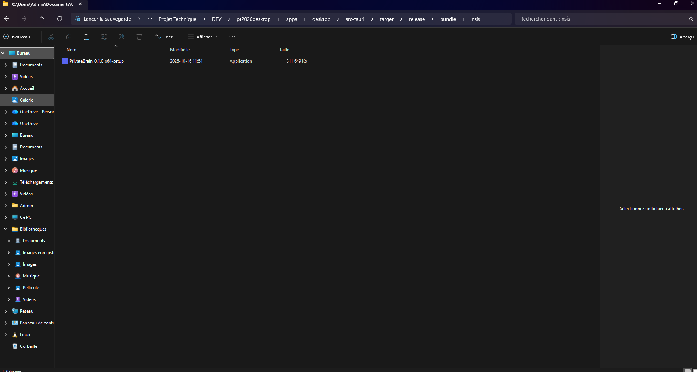 |
| 2–3. Lancement | 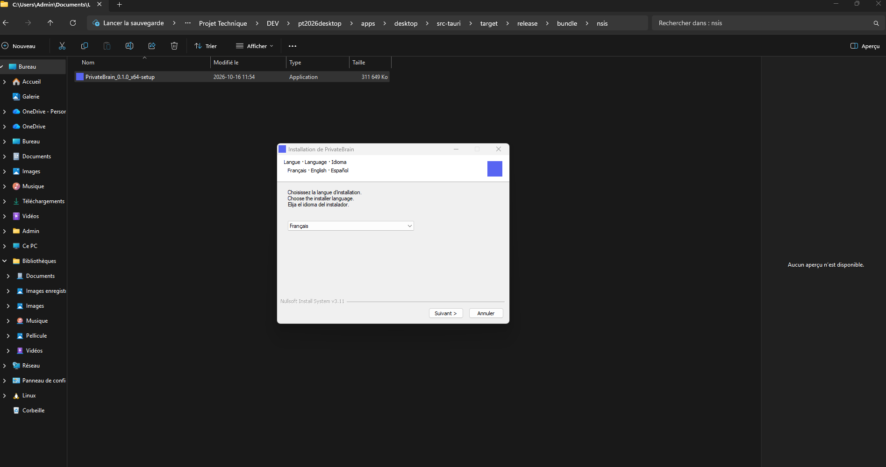 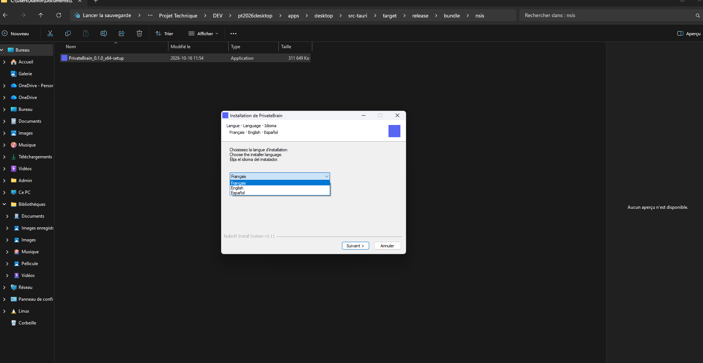 |
| 4. Bienvenue | 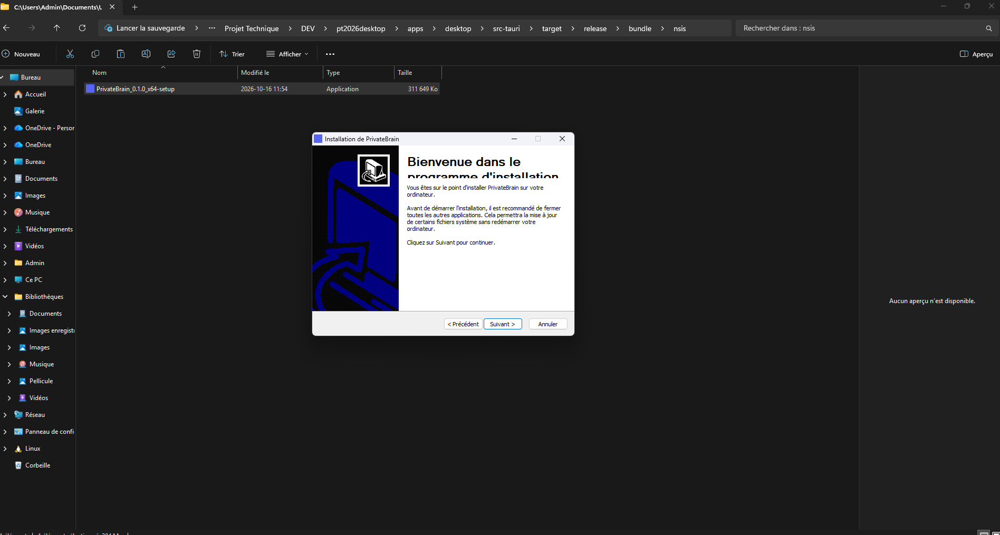 |
| 5–7. Options |  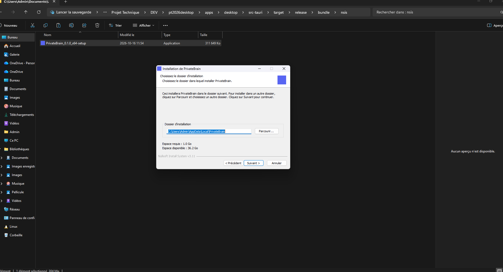 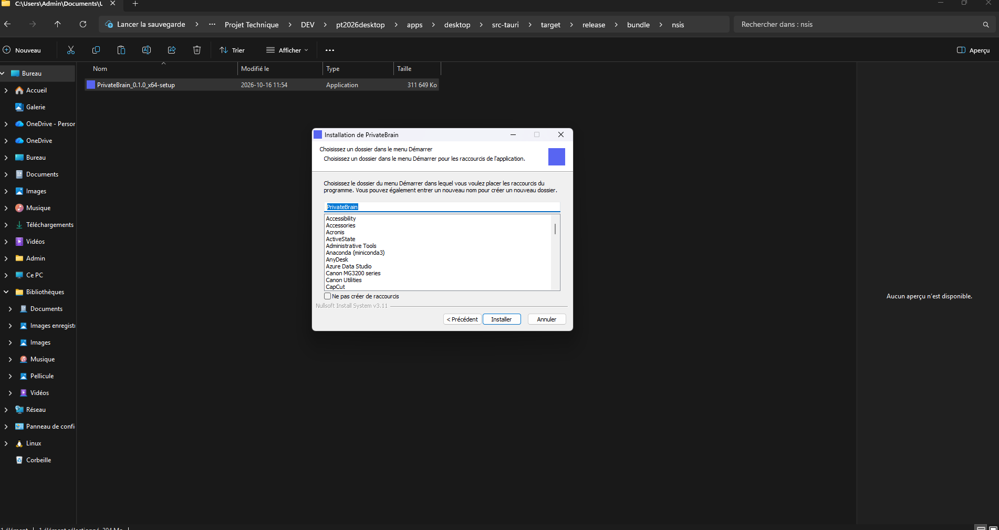 |
| 8. Installation en cours | 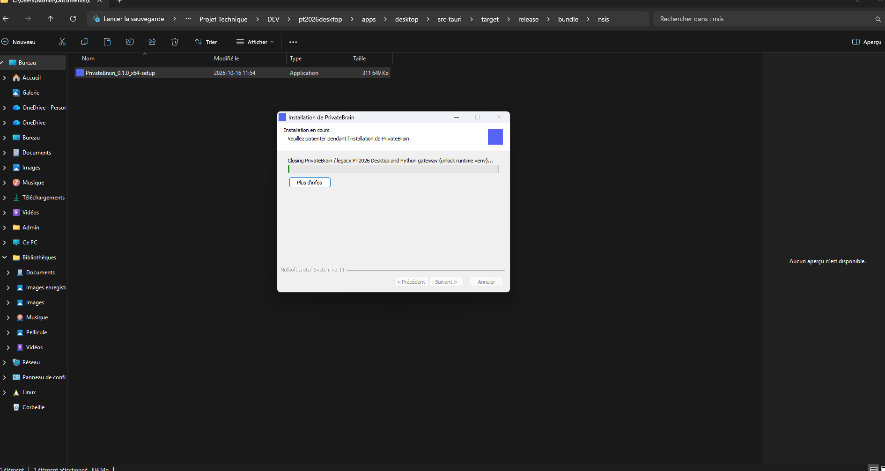 |
| 9–14. Fin de l'installateur | 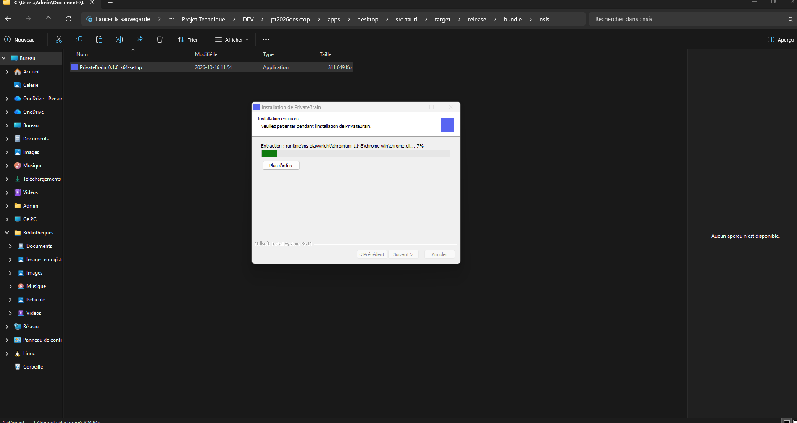 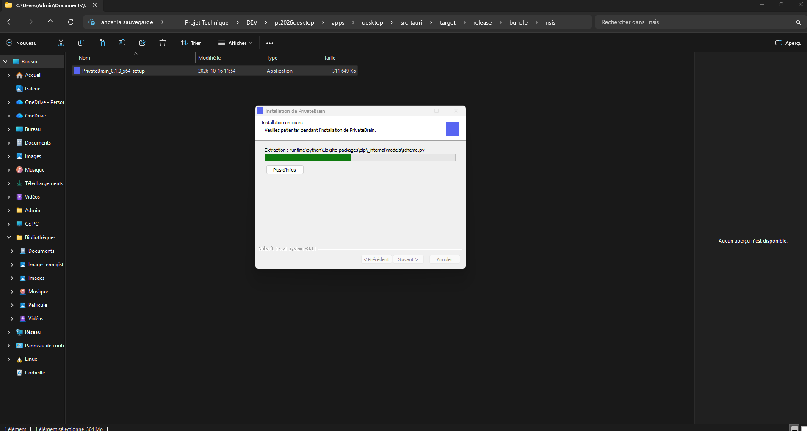 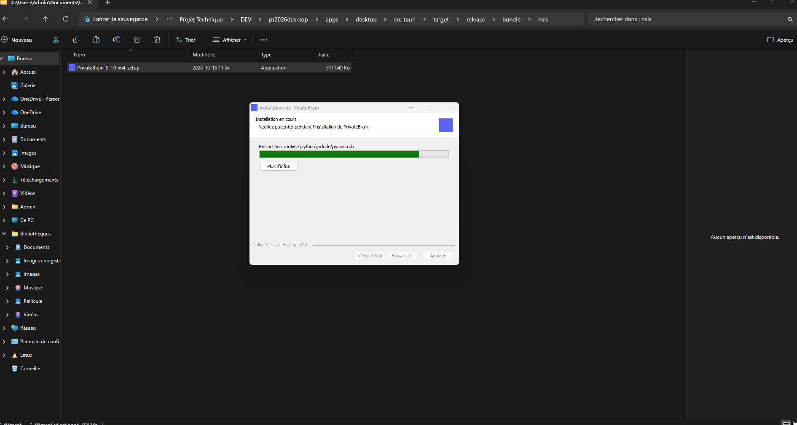 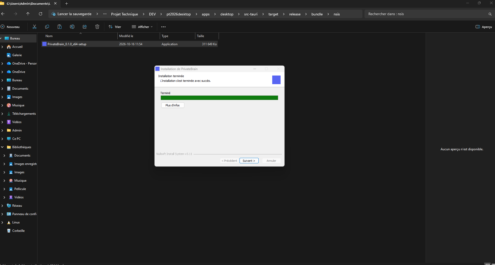 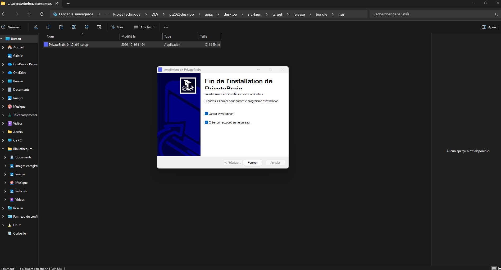 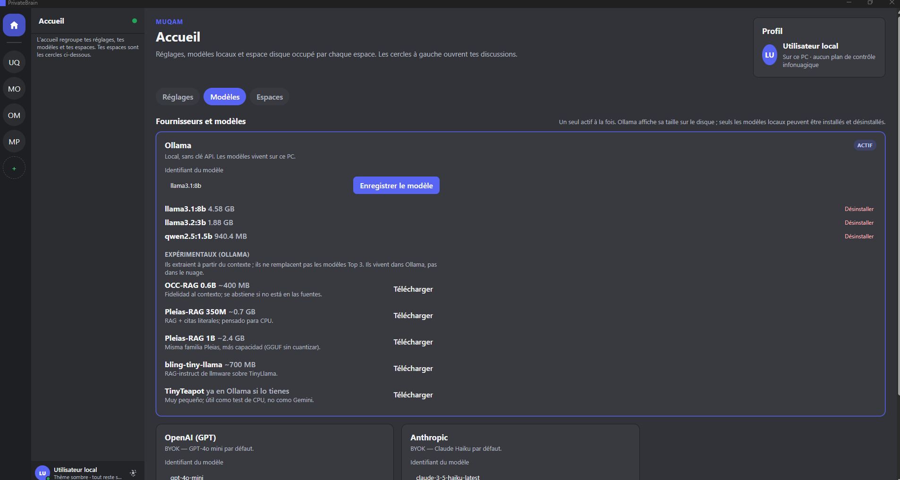 |
| 15. Application ouverte | 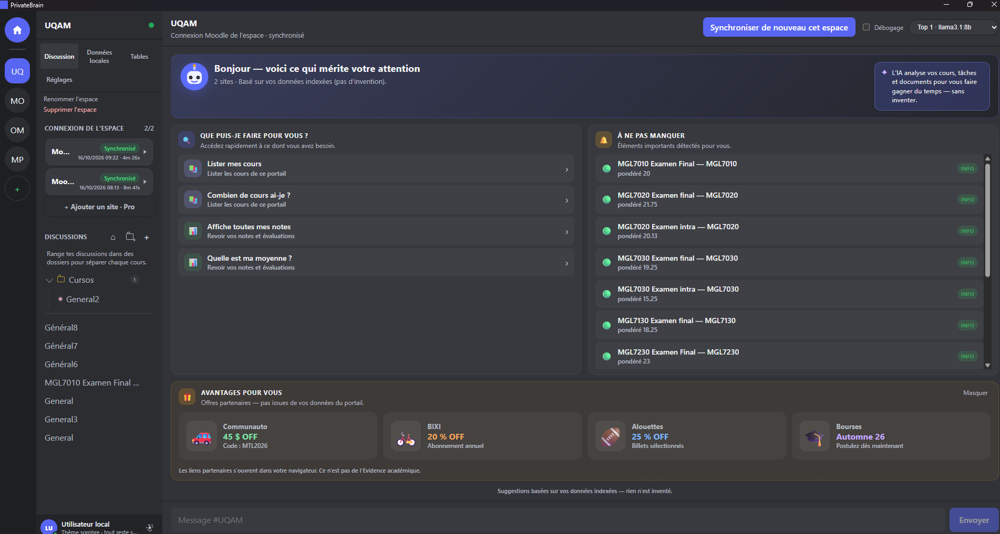 |

Le texte détaillé (SmartScreen, langue, etc.) est dans [Installer l'application](../01-installer.md).
